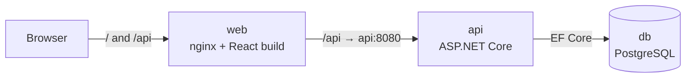

# Harbor Hotel – Hotel Booking System

A full-stack hotel booking system. Guests search for free rooms, book them and manage their bookings. Front-desk staff see the day's arrivals and departures and check guests in and out.

**Stack:** ASP.NET Core Web API (.NET 10) · EF Core + PostgreSQL · JWT auth · xUnit + Testcontainers · React + TypeScript + Vite · Docker Compose

## Quick start

Requires Docker.

```bash
docker compose up --build
```

| What | URL |
|---|---|
| Web app | http://localhost:3000 |
| Swagger UI | http://localhost:8080/swagger |

On first start the API creates the database schema and seeds six rooms and a staff account:

| Role | Email | Password |
|---|---|---|
| Staff | `staff@hotel.local` | `Staff123!` |
| Guest | register on the Sign up page | |

Ports, database credentials, the JWT signing key and the staff login can be overridden by copying `.env.example` to `.env`.

## Architecture



nginx serves the React app and forwards `/api` to the API, so the browser only ever talks to one origin and the API needs no CORS setup. During development the Vite dev server does the same forwarding.

### Backend layers

```
backend/src/
├─ HotelBooking.Domain          Entities and business rules. No dependencies.
├─ HotelBooking.Infrastructure  EF Core DbContext, table mappings, migrations.
└─ HotelBooking.Api             Controllers, DTOs, services, JWT auth, error handling.
```

References only point inward (`Api → Infrastructure → Domain`), so business rules never depend on the database or HTTP.

- **Domain** – `Room`, `User` and `Reservation`. The entities have private setters and only change through methods that enforce the rules. For example, `Reservation.CheckIn()` refuses a cancelled booking or a check-in before the arrival date. The lifecycle is `Confirmed → CheckedIn → CheckedOut`, or `Confirmed → Cancelled`.
- **Infrastructure** – one `IEntityTypeConfiguration` per entity. Tables use snake_case names and enums are stored as readable strings.
- **Api** – thin controllers call services such as `ReservationService`. Services use the `DbContext` directly: EF Core already is a repository and unit of work, so there's no extra repository layer. A global exception handler turns `DomainException` into 400, `NotFoundException` into 404 and `ConflictException` into 409, all as RFC 7807 `ProblemDetails`.

### How double booking is prevented

A stay covers the nights `[checkIn, checkOut)`. The check-out day is not included, so one guest can leave on the morning another arrives. Two layers protect against double booking:

1. **Application check.** Before inserting, `ReservationService` looks for an overlapping active reservation and returns a friendly `409 Conflict`.
2. **Database guarantee.** Two requests can both pass step 1 before either one saves. To catch that, PostgreSQL has an **exclusion constraint**:

   ```sql
   EXCLUDE USING gist (room_id WITH =, daterange(check_in_date, check_out_date, '[)') WITH &&)
   WHERE (status <> 'Cancelled')
   ```

   This means no two non-cancelled rows may share a `room_id` and have overlapping date ranges. The database rejects the losing insert, and the API translates that error into the same 409. An integration test fires 10 simultaneous bookings for one room and asserts that exactly one succeeds.

### Authentication

`POST /api/auth/register` creates a **Guest** account and `POST /api/auth/login` returns a signed JWT. Staff accounts are only created by seeding. Passwords are hashed with ASP.NET Core's `PasswordHasher`. Endpoints are protected with `[Authorize(Roles = "Staff")]` / `[Authorize(Roles = "Guest")]`. A guest asking for someone else's reservation gets a 404, not a 403, so reservation ids can't be probed.

The frontend keeps the token in `localStorage`, attaches it to every request, and signs the user out if the API answers 401. Route guards in React only improve the experience. The API enforces every rule itself.

## API overview

| Method | Route | Who |
|---|---|---|
| POST | `/api/auth/register`, `/api/auth/login` | anyone |
| GET | `/api/auth/me` | signed in |
| GET | `/api/rooms`, `/api/rooms/{id}` | anyone |
| GET | `/api/rooms/available?checkIn=2026-12-01&checkOut=2026-12-04&guests=2` | anyone |
| POST / PUT / DELETE | `/api/rooms`, `/api/rooms/{id}` | Staff |
| POST | `/api/reservations` | Guest |
| GET | `/api/reservations/mine` | Guest |
| GET | `/api/reservations/{id}` | owner or Staff |
| POST | `/api/reservations/{id}/cancel` | owner or Staff |
| GET | `/api/staff/arrivals?date=`, `/api/staff/departures?date=` | Staff |
| POST | `/api/staff/reservations/{id}/check-in`, `/check-out` | Staff |

Full request and response schemas are in Swagger.

## Frontend

```
frontend/src/
├─ api/          fetch wrapper (adds JWT, parses ProblemDetails) + typed endpoint functions
├─ auth/         AuthProvider / useAuth, ProtectedRoute
├─ components/   Layout (role-aware navbar), StatusBadge, ErrorMessage
├─ pages/        Login, Register
│  ├─ guest/     SearchPage, BookPage, MyBookingsPage
│  └─ staff/     FrontDeskPage
├─ types/        TypeScript mirrors of the API contracts
└─ utils/        date and price formatting
```

Search criteria are kept in the URL, so results survive a reload. If a room is taken between search and confirmation, the booking page shows a dedicated "just booked by someone else" message.

## Running locally without Docker for the app

```bash
docker compose up -d db                               # just PostgreSQL
dotnet run --project backend/src/HotelBooking.Api     # http://localhost:5284/swagger
cd frontend && npm install && npm run dev             # http://localhost:5173
```

In Development the API migrates and seeds the database on startup. To add a migration:

```bash
dotnet tool restore
dotnet ef migrations add <Name> --project backend/src/HotelBooking.Infrastructure --startup-project backend/src/HotelBooking.Api --output-dir Migrations
```

## Tests

```bash
dotnet test backend
```

- **Unit tests** cover the domain rules: dates, capacity, pricing and status transitions. They need no database.
- **Integration tests** start the real API in memory with `WebApplicationFactory`, against a throwaway PostgreSQL container from **Testcontainers**. They exercise the real migrations and constraints: auth and roles, booking rules, availability, cancellation, the full check-in/check-out flow, and concurrent double-booking. Docker must be running.

## Simplifications and possible next steps

- "Today" is the UTC date. A real hotel would use its local time zone.
- The staff account is seeded. There's no admin UI for managing staff or rooms yet; the room CRUD endpoints exist.
- Possible additions: payments, room photos, refresh tokens, rate limiting on login, and frontend tests (Vitest + React Testing Library).
